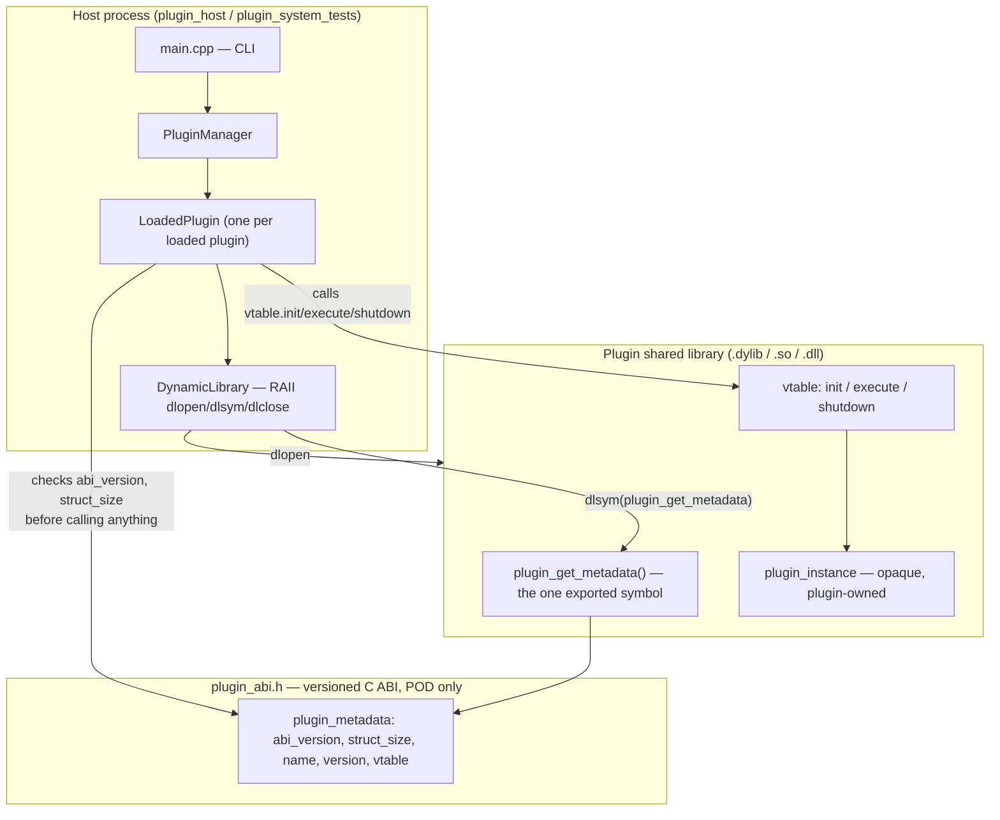

# plugin-system-cpp

A C++ host application that loads plugins at runtime across a versioned, POD-only C ABI boundary, using `dlopen`/`dlsym`/`dlclose` on POSIX (with a documented, untested Windows `LoadLibrary` path behind `#ifdef _WIN32`).

## Problem

A host application wants to be extended with new behavior (string transforms, math operations, logging) without being recompiled, and without the extension author needing the host's source. The classic unsafe way to do this in C++ is to export C++ classes/virtual functions across a shared-library boundary — which breaks the moment the host and the plugin are compiled by different compiler versions, different standard library implementations, or even just different optimization flags, because C++ ABI (vtable layout, name mangling, exception tables, STL container layout) is not guaranteed stable across any of those. This project builds the alternative: a stable **C** ABI boundary, with the C++ convenience layered on *top* of it, independently, on each side.

## Features

- Versioned C ABI (`include/plugin_abi.h`): opaque handles, POD-only structs, explicit `abi_version` + `struct_size` checks performed *before* any function pointer in the plugin's vtable is ever called.
- RAII loader (`DynamicLibrary`, `src/host/dynamic_library.{hpp,cpp}`) wrapping `dlopen`/`dlsym`/`dlclose` (POSIX) or `LoadLibrary`/`GetProcAddress`/`FreeLibrary` (Windows, `#ifdef _WIN32`, untested).
- `PluginManager` (`src/host/plugin_manager.{hpp,cpp}`): host-owned lifecycle — `init()` exactly once, `shutdown()` exactly once (idempotent, guarded), unload in strict reverse-of-load order, clean survival of every documented failure mode.
- Directory scanning that loads every platform-appropriate shared library in a directory and reports a per-file result instead of aborting on the first bad file.
- A CLI (`plugin_host`) to load one plugin or scan a directory, optionally executing it with a given input string.
- 3 example plugins (`reverse_string`, `math_ops`, `logging_counter`) and 6 broken/instrumented test fixtures that exercise every documented failure and lifecycle path.
- 21 GoogleTest unit tests, all green under plain Debug, AddressSanitizer+UndefinedBehaviorSanitizer, and ThreadSanitizer builds.

## Architecture



## Module-by-module walkthrough

### `include/plugin_abi.h`
The entire contract. `plugin_metadata` is a POD struct with `abi_version` and `struct_size` as its *first two fields, in that order* — deliberately, so a host can read and validate them even against a plugin built for a completely different, hypothetical future ABI generation that might not share any other field. `plugin_instance` and `plugin_host_context` are forward-declared only; the host carries the pointer and never dereferences it. No `std::string`, `std::function`, or virtual function appears anywhere in this file — see the file's own header comment for the full list of rules and why each exists.

### `include/plugin_helper.h`
A tiny `memcpy`-based helper (`plugin_helper_copy_fixed`) shared only by the example/fixture plugins in this repo to safely fill the fixed-size `name`/`version` char arrays. Not part of the ABI; a plugin author is free not to use it.

### `src/host/dynamic_library.{hpp,cpp}` — `DynamicLibrary`
RAII wrapper around one OS library handle. Move-only (one handle, one owner). `load()` uses `RTLD_NOW | RTLD_LOCAL` on POSIX deliberately (see in-code comment): resolving all symbols at load time surfaces a plugin binary's own missing-symbol problems immediately, in the one place the host already handles failure, rather than nondeterministically later. `resolve_symbol()` clears `dlerror()` before calling `dlsym()` because a legitimately-nullptr-valued symbol is indistinguishable from "not found" by return value alone — only the post-call `dlerror()` state tells them apart. The `#ifdef _WIN32` branch compiles to `LoadLibraryA`/`GetProcAddress`/`FreeLibrary`; it has never been compiled or run (this machine is macOS), so it is documented as unverified.

### `src/host/plugin_manager.{hpp,cpp}` — `LoadedPlugin` and `PluginManager`
`PluginManager::load()` is the single choke point for every documented failure mode: file not found, `dlopen` failure, missing `plugin_get_metadata` symbol, null metadata, ABI version mismatch, struct-size mismatch, a missing required vtable function, and `init()` failure — each reported as a distinct `LoadError` with a human-readable message, and each one leaves the host in exactly the state it was in before the call (the `DynamicLibrary` RAII member unloads itself if `load()` returns early). Only on full success is a `LoadedPlugin` constructed and pushed onto `plugins_`. `LoadedPlugin::shutdown_once()` is the idempotency guard: a `PluginLifecycleState` flag ensures the plugin's real `shutdown()` runs at most once no matter how many times host code calls it (directly, or via `unload_all()`'s internal reverse teardown). `PluginManager::unload_all()` pops from the back of `plugins_`, which is exactly LIFO relative to `load()` calls, satisfying "unload in strict reverse of load order."

### `src/host/main.cpp`
A minimal CLI (`load <path> [input]` / `scan <dir> [input]`) over `PluginManager`, mostly useful as a runnable demo and as the thing `scripts/build_and_test.sh` exercises at the end of a clean build.

### Example plugins (`plugins/*/`)
- `reverse_string`: reverses the input string in place into the output buffer.
- `math_ops`: parses `"op,a,b"` (op ∈ {add,sub,mul,div}) with `sscanf` entirely inside the plugin's own translation unit — no STL type ever crosses the ABI, only a `char*`/`size_t` buffer.
- `logging_counter`: keeps a per-instance call counter in its `plugin_instance`, demonstrating real plugin-private state that outlives individual `execute()` calls.

### Test fixtures (`tests/fixtures/*/`)
Six fixtures, each engineered to trigger exactly one failure or lifecycle edge case: `bad_abi_version`, `bad_struct_size`, `missing_symbol`, `init_fail`, `shutdown_counter` (counts real `shutdown()` invocations via a `fixture_get_shutdown_count` diagnostic export), and `order_tracker` (built three times under different `-DORDER_TRACKER_NAME` values from one source file, each instance logging `init:<name>`/`shutdown:<name>` to a file named by an environment variable, so load/unload order is observed from *inside* the plugins, not just trusted from host bookkeeping).

## Data flow

1. `PluginManager::load(path)` constructs a `DynamicLibrary` and calls `load()` → `dlopen`.
2. Resolves `plugin_get_metadata` by name (fixed C-linkage symbol, immune to C++ name mangling) and calls it.
3. Validates `abi_version`, then `struct_size`, in that order, before trusting any other field.
4. Calls `vtable.init()` exactly once; on any failure up to and including this step, the `DynamicLibrary` unwinds (RAII) and nothing is left loaded.
5. On success, a `LoadedPlugin` is pushed onto the manager's stack; `execute()` calls are forwarded through `vtable.execute` until `shutdown_once()` is called (directly or via `unload_all()`), after which `execute()` returns `PLUGIN_STATUS_NOT_INITIALIZED` instead of touching a dangling instance pointer.
6. `unload_all()` (or the `PluginManager` destructor) walks the stack back-to-front: `shutdown_once()` then pop (which destroys the `DynamicLibrary`, triggering `dlclose`).

## Design decisions and trade-offs

- **C ABI instead of a COM-style C++ abstract-base-class ABI.** A pure-virtual-class boundary is more ergonomic to write on both sides, but its layout depends on the compiler's C++ ABI (vtable order, RTTI, exception personality routines), which is not guaranteed stable even between two builds of the same compiler with different flags. A POD `struct` of function pointers has a layout fixed by the C ABI, which *is* stable across the compilers this project targets. Rejected the C++ route because the entire point of a plugin system is to tolerate the plugin being built independently of the host.
- **`abi_version` *and* `struct_size`, not just one.** `abi_version` alone cannot catch a case where someone changes `plugin_metadata`'s layout (e.g. field padding from a mixed 32/64-bit or mixed-arch build) without remembering to bump the version constant; `struct_size` alone cannot give a human-readable "you're on an old/new ABI generation" message. Checked in that order (version first) because a sufficiently different ABI generation might not even have a `struct_size` field at the same offset.
- **Fixed-size `char[]` for name/version instead of `const char*`.** A pointer would need the plugin to guarantee the string's storage outlives the metadata struct and would raise an ownership question across the ABI (who frees it, with which allocator). A fixed buffer is self-contained POD with no lifetime question.
- **Host-owned lifecycle stack (LIFO unload) instead of leaving unload order to the caller.** The example plugins today don't depend on each other, but a host that didn't enforce reverse-of-load order would be unsafe to extend with plugins that do have dependencies (the common shared-library convention). Enforcing it now costs nothing and avoids a footgun later.
- **`RTLD_NOW` instead of `RTLD_LAZY`.** Slightly slower per-load, but any missing-symbol problem *inside* the plugin binary itself surfaces immediately at `load()` time in the one place failures are already handled, rather than nondeterministically the first time some rarely-used internal function is called.
- **CMake `MODULE` libraries with an explicitly pinned suffix.** `MODULE` defaults to `CMAKE_SHARED_MODULE_SUFFIX`, which historically has not reliably been `.dylib` on Apple platforms for loadable modules. Since the spec (and the directory scanner) need to know the exact extension to look for, the suffix is pinned explicitly per platform in `CMakeLists.txt` rather than trusted to the default.
- **No exceptions across the ABI, anywhere, including host-internal RAII helpers.** `DynamicLibrary` is host-only code that could technically throw and still be ABI-safe (it never crosses into a plugin), but it deliberately reports failure via return value instead, so there is exactly one error-handling discipline across the whole loader rather than two.
- **Windows `LoadLibrary` path written but not tested.** The spec asks for it to compile only on Windows via `#ifdef _WIN32`; it does, following the same structure as the POSIX path, but this machine is macOS so it has never actually been built or run. Documented as a limitation rather than claimed as verified.

## Complexity analysis

- `PluginManager::load()`: O(1) besides the underlying `dlopen`/`dlsym` cost (dominated by the OS loader, not by this code).
- `PluginManager::load_directory()`: O(n log n) for the directory listing (sorted for deterministic, reproducible scan order) plus O(n) individual loads.
- `PluginManager::unload_all()`: O(n) in the number of currently loaded plugins, each `dlclose` being O(1) from this code's perspective.
- Memory: one `DynamicLibrary` + one `LoadedPlugin` heap node (via `std::unique_ptr`) per loaded plugin; no unbounded growth, no caching beyond what's currently loaded.

## Build / run / test

### macOS / Linux

```sh
./scripts/build_and_test.sh
```

This bootstraps `cmake` via a project-local `pip`-installed copy if it isn't already on `PATH` (no `sudo`, no global install), then configures/builds/tests three independent build directories (`build` Debug, `build-asan` ASan+UBSan, `build-tsan` ThreadSanitizer), then runs the CLI demo against a single plugin, a clean directory, and a mixed directory.

Manual equivalent:

```sh
cmake -S . -B build -DCMAKE_BUILD_TYPE=Debug
cmake --build build -j
ctest --test-dir build --output-on-failure
```

### Sanitizer builds

```sh
cmake -S . -B build-asan -DCMAKE_BUILD_TYPE=Debug -DENABLE_ASAN=ON
cmake --build build-asan -j && ctest --test-dir build-asan --output-on-failure

cmake -S . -B build-tsan -DCMAKE_BUILD_TYPE=Debug -DENABLE_TSAN=ON
cmake --build build-tsan -j && ctest --test-dir build-tsan --output-on-failure
```

(`ENABLE_ASAN` enables AddressSanitizer *and* UndefinedBehaviorSanitizer together via `-fsanitize=address,undefined`. LeakSanitizer's `detect_leaks=1` is **not supported on macOS** — AddressSanitizer itself prints `AddressSanitizer: detect_leaks is not supported on this platform` and aborts if you force it via `ASAN_OPTIONS`; this is a known Apple-platform limitation, not a bug in this project. Leak checking under ASan does work on Linux and runs there in CI.)

## Demo walkthrough (real output on this Mac)

```
$ ./build/plugin_host load ./build/reverse_string.dylib "hello world"
[OK]   ./build/reverse_string.dylib             loaded (index=0)
       execute("hello world") -> "dlrow olleh"
       unloaded cleanly

$ ./build/plugin_host scan ./build/good_plugins "hello"
[OK]   ./build/good_plugins                     loaded (index=0)
[OK]   ./build/good_plugins                     loaded (index=1)
[OK]   ./build/good_plugins                     loaded (index=2)
       execute("hello") -> "count=1 last_input=hello"
       execute("hello") failed with status 2
       execute("hello") -> "olleh"
scan summary: 3 succeeded, 0 failed, out of 3 attempted
all plugins unloaded cleanly

$ ./build/plugin_host scan ./build/mixed_plugins "hello"
[FAIL] ./build/mixed_plugins                    AbiVersionMismatch: ABI version mismatch: host expects 1, plugin reports 778
[FAIL] ./build/mixed_plugins                    StructSizeMismatch: metadata struct size mismatch: host expects 128, plugin reports 144
[FAIL] ./build/mixed_plugins                    InitFailed: plugin init() failed with status 1
[FAIL] ./build/mixed_plugins                    MissingMetadataSymbol: plugin does not export 'plugin_get_metadata': dlsym could not find symbol 'plugin_get_metadata': ...
[OK]   ./build/mixed_plugins                    loaded (index=0)
[OK]   ./build/mixed_plugins                    loaded (index=1)
[OK]   ./build/mixed_plugins                    loaded (index=2)
       execute("hello") -> "count=1 last_input=hello"
       execute("hello") failed with status 2
       execute("hello") -> "olleh"
scan summary: 3 succeeded, 4 failed, out of 7 attempted
all plugins unloaded cleanly
```

(The `math_ops` plugin's `execute("hello")` correctly fails with status 2 / `PLUGIN_STATUS_INVALID_ARGUMENT` — `"hello"` doesn't parse as `"op,a,b"`. That's the plugin behaving correctly on bad input, not a host bug.)

## Benchmark methodology and measured results

This project is correctness-focused (a loader, not a hot path), so no formal throughput benchmark suite is included. One informal, labeled measurement: 200 back-to-back invocations of `./build/plugin_host load ./build/math_ops.dylib "add,2,3"` (each a fresh process: fork+exec, dlopen, resolve, init, execute, shutdown, dlclose, exit) took **0.867s wall-clock total ≈ 4.3ms per full cycle**, measured on this machine (Apple Silicon Mac, macOS 27.0, Apple clang 21.0.0, Debug build, unoptimized, 2026-11-23). This number is dominated by process-spawn overhead, not by the loader itself, and is reported only as an informal sanity check — not as a `dlopen` micro-benchmark — since this project does not isolate or repeat-measure that call in isolation.

## Testing strategy

21 GoogleTest cases across 6 files:
- `test_abi_layout.cpp`: `plugin_metadata`'s size is stable, `PLUGIN_ABI_VERSION` is non-zero, name/version fields are fixed-size arrays.
- `test_loader_success.cpp`: each example plugin loads, executes, and unloads; metadata is readable before `execute()`.
- `test_loader_failures.cpp`: file-not-found, missing symbol, ABI version mismatch, struct-size mismatch, init failure, and that the host survives several consecutive bad loads in a row.
- `test_lifecycle.cpp`: `shutdown()` fires exactly once across repeated `shutdown_once()` calls (including a third call simulating what `unload_all()` does internally); `execute()` after shutdown fails cleanly instead of crashing; an init failure leaves the host fully functional for the next load.
- `test_directory_scan.cpp`: an all-good directory loads everything; a mixed directory reports every file without aborting the scan; a nonexistent directory is reported cleanly.
- `test_unload_order.cpp`: three `order_tracker` instances, loaded A→B→C, verify strict reverse unload order (`unload_all()`, and manually one-at-a-time) via a log file written from *inside* each plugin's own `init()`/`shutdown()`.

All 21 pass under plain Debug, ASan+UBSan, and ThreadSanitizer builds on this Mac.

## Limitations

- Host/plugin interaction is single-threaded by design — the host loads, initializes, calls, and shuts down plugins sequentially from one thread. `ENABLE_TSAN` is provided and run in CI for consistency with the other sanitizers, but is not expected to find anything because there is no concurrency to race on. A concurrent host (e.g. one calling `execute()` on the same `LoadedPlugin` from multiple threads) is out of scope.
- The Windows `LoadLibrary`/`GetProcAddress`/`FreeLibrary` path in `dynamic_library.cpp` compiles only under `#ifdef _WIN32` and has never been built or run — this machine is macOS. Treat it as unverified.
- LeakSanitizer (`detect_leaks=1`) is not supported by AddressSanitizer on macOS at all (an Apple-platform limitation, not something this project can fix); leak checking only actually runs under ASan on Linux, including in CI.
- No sandboxing of plugin code: a loaded plugin runs with the full privileges and address space of the host process. This is a trusted-plugin model, not a security boundary.
- `execute()`'s output buffer is fixed-size and caller-provided (no growable/streaming output); large results must fail with `PLUGIN_STATUS_BUFFER_TOO_SMALL` rather than being handled incrementally.

## Future work

- A real sandboxed/untrusted-plugin mode (separate process + IPC) instead of in-process `dlopen`.
- A capability/versioned-extension-point discovery mechanism richer than a single fixed vtable, so plugins could opt into additional, optional function tables without another ABI version bump for every addition.
- Actually building and testing the Windows path on a Windows machine or CI runner.
- Hot-reload (unload + reload the same plugin path without restarting the host).

## What I learned

Writing the ABI header first, before any implementation, made the rest of the project fall out naturally — most of the "what failure modes does this need to survive" design work happened while deciding what *couldn't* safely cross that boundary (anything non-POD) and what had to be checked, and in what order, before the metadata struct could be trusted at all (`abi_version` before `struct_size`, both before touching `name`/`version`/`vtable`). The one real bug this build caught was in a *test*, not the host: `test_lifecycle.cpp` originally called a function pointer resolved from inside a plugin (`fixture_get_shutdown_count`) *after* `PluginManager::unload_all()` had already `dlclose`'d that same plugin — a textbook use-after-unload, reliably segfaulting under `ctest`. The fix wasn't in the host at all; it was restructuring the test to make its last assertion about the shutdown counter *before* the library backing that function pointer is unmapped, which is a good concrete illustration of why `shutdown_once()`'s dangling-instance-pointer discipline (`instance_ = nullptr` the moment `shutdown()` runs) exists in the host in the first place.

## Scripts and tools bootstrapped during this build

`cmake`/`ctest` were not present on `PATH` in this build environment and Homebrew's prefix was not writable without `sudo` (which this workflow is not permitted to use). They were installed via `python3 -m pip install --user cmake` (the official PyPI `cmake` wheel, which bundles prebuilt binaries) and made available on `PATH` by symlinking into the already-writable, already-on-`PATH` `/opt/homebrew/bin`. `scripts/build_and_test.sh` reproduces the no-`sudo` bootstrap automatically (into a project-local `.venv`) for anyone running it on a machine where `cmake` is genuinely absent.
